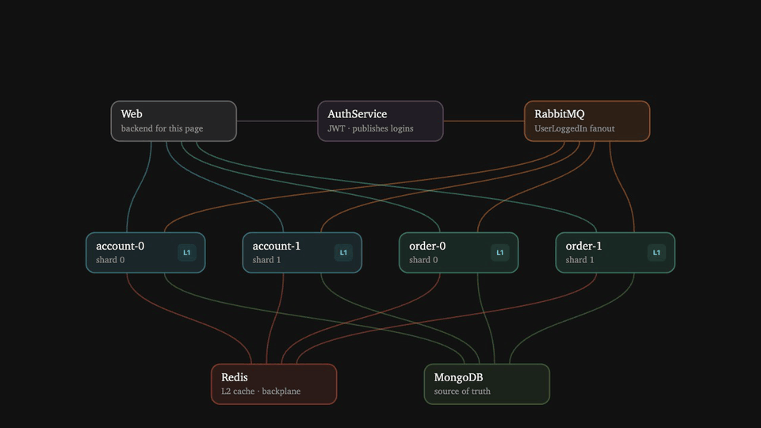
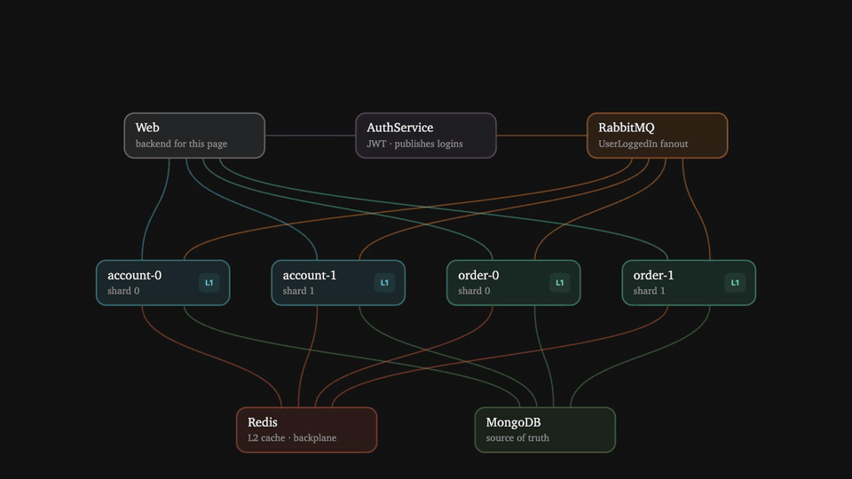
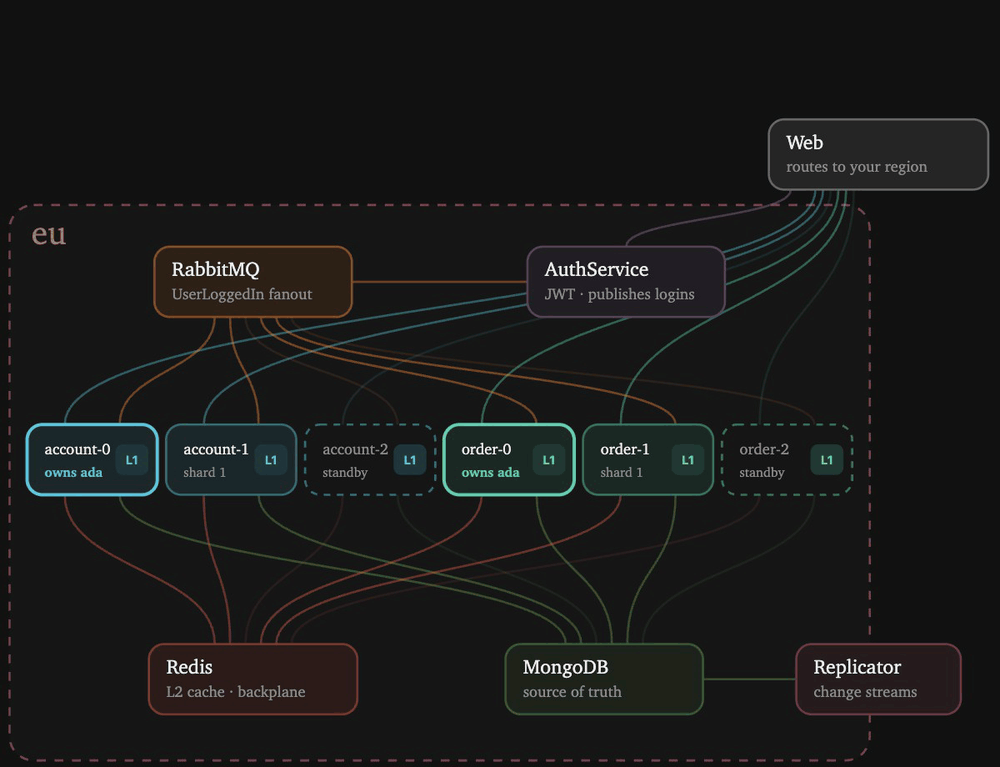
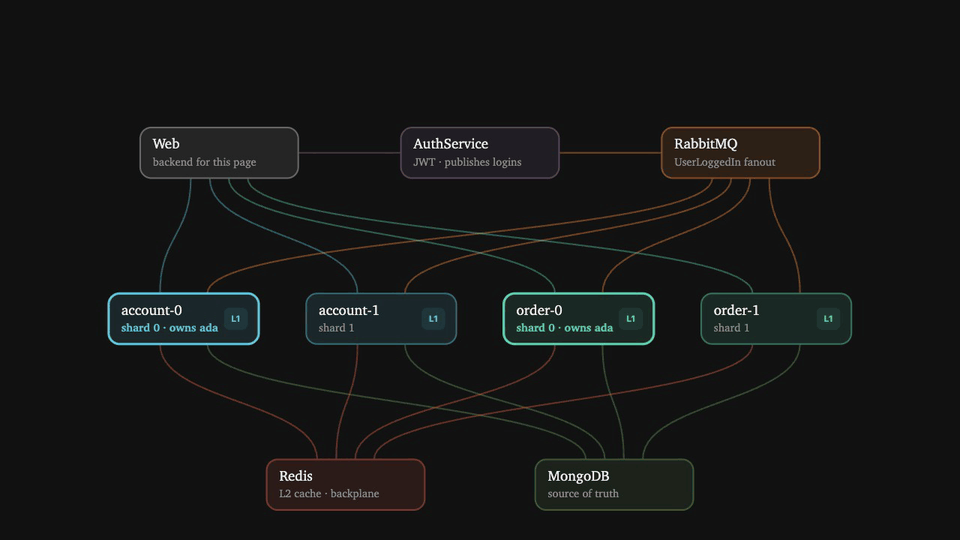
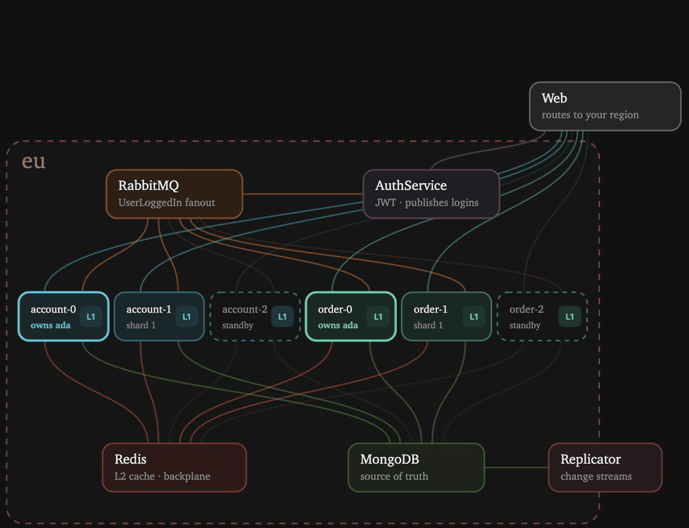

# Sharded hybrid cache

A live, animated demo of a sharded two-level cache in .NET. Each service runs as several shard instances and each instance uses
[FusionCache](https://github.com/ZiggyCreatures/FusionCache) with in-process memory (L1), Redis (L2) and a Redis backplane.
Every user belongs to one shard, which warms its cache the moment that user logs in.

Each service narrates what it does over Redis pub/sub. The demo page plays the narration back step by step: a dot travels each hop, colored by what happened (hit, miss, ignored, rejected).


## Walkthrough

These are real recordings of the demo page's animation running against the app at 1× speed, with the controls and log left out.
The app runs 2 shards, so there are 4 service instances:
account-0, account-1, order-0 and order-1. The user is `ada`, and `md5("ada") % 2` makes **shard 0 her owner**.

### 1. No token, no entry



Before logging in, **Get account** goes to account-0 without a JWT. The gRPC service rejects it with `Unauthenticated` (red),
so the request never reaches the cache.

### 2. Logging in warms the owner's cache



1. AuthService issues a JWT and publishes `UserLoggedIn` to a RabbitMQ fanout exchange.
   The page gets its token right away. The rest happens in the background.
2. RabbitMQ delivers the message to all four instances, and each one checks who owns `ada`.
   account-0 and order-0 own her, so they start warming their caches. account-1 and order-1 ignore the message (grey).
3. The owners have never seen `ada`, so they miss in L1 (memory) and in L2 (Redis). They load her account and orders from MongoDB and save them to L1 + L2.
4. Saving also sends a backplane message. The other instances hear it, but they hold no copy, so there's nothing to refresh.

### 3. Owner shard: an L1 hit



**Get account** goes to account-0, the owner. Login already put `ada` into its memory, so this is an L1 hit, answered
without a single network hop. This is the path that sharding by user is built for.

### 4. Wrong shard: the cold path



The same call goes to account-1 this time. The orange request means it's not the owner. Its memory is empty, so L1 misses.
Redis has the copy the owner saved at login, so L2 hits and the value is copied into account-1's memory.
There's no database trip, but there is a network hop that the owner would have skipped.

### 5. An update every instance hears



**Update account** runs on the owner, account-0:

1. It writes MongoDB first, the source of truth, and then L1 + L2.
2. It publishes a backplane message saying `account:ada` changed.
3. account-1 hears it. The wrong-shard read in step 4 left it holding a copy in L1, which is now stale, so it refreshes that copy from Redis.

No instance serves the old value, and no instance had to go back to the database for the new one.

## Architecture

```
            ┌──────── Web :5050 (demo page + backend) ────────┐
            │ HTTP                                    gRPC    │
            ▼                                                 ▼
     AuthService :5000 ──► RabbitMQ ──fanout──►  account-0, account-1  :5100+
       (JWT)          UserLoggedIn               order-0,   order-1    :5200+
                                                 (each with its own L1 memory)
                                                          │
                                       ┌──────────────────┴──────────────┐
                                       ▼                                 ▼
                              Redis: L2 + backplane              MongoDB: source of truth
```

[.NET Aspire](https://aspire.dev) runs everything. It starts the services and the Redis, RabbitMQ and MongoDB containers, and it collects traces, metrics and logs in its dashboard.

## Run it

You need the [.NET 10 SDK](https://dotnet.microsoft.com/download) and Docker or Podman.

```sh
dotnet run --project AppHost
```

- Demo page: http://localhost:5050
- Aspire dashboard: http://localhost:15000 (the login link is printed in the console)

With Podman, first run `export ASPIRE_CONTAINER_RUNTIME=podman`.
To change the number of shards, edit `shards` in [`AppHost/AppHost.cs`](AppHost/AppHost.cs).

## Using the page

1. **Log in** with any name. The owner shard is highlighted in the diagram.
2. **Pick an action**, such as Get account or Add order. It opens with its fields and a shard picker, which defaults to the owner. Press **Run**.
3. Watch the story. Use **Speed** to slow it down, or turn on **Step by step** and advance with the button, `→` or a presenter clicker (`PageDown`).

## Project layout

| Path | What's in it |
|------|--------------|
| `AppHost/` | Aspire orchestration: containers, services, shard count, ports |
| `AuthService/` | Login: issues the JWT, publishes `UserLoggedIn` |
| `AccountService/`, `OrderService/` | Sharded gRPC services behind JWT, reading through FusionCache |
| `Shared/Demo.cs` | What the services share: JWT setup, sharding, FusionCache config, cache warming on login |
| `Shared/Timeline.cs` | The narration: turns FusionCache events into steps for the page |
| `Web/` | Backend for the page (browsers can't call gRPC) and `wwwroot/index.html`. GSAP is vendored so it works offline |

## Demo shortcuts

This is a conference demo, not production code:

- There are no passwords: any name gets a token. The JWT signing key is hardcoded in `Shared/Demo.cs`.
- Each instance listens on a throwaway RabbitMQ queue, so logins that happen while a shard is down are lost.
