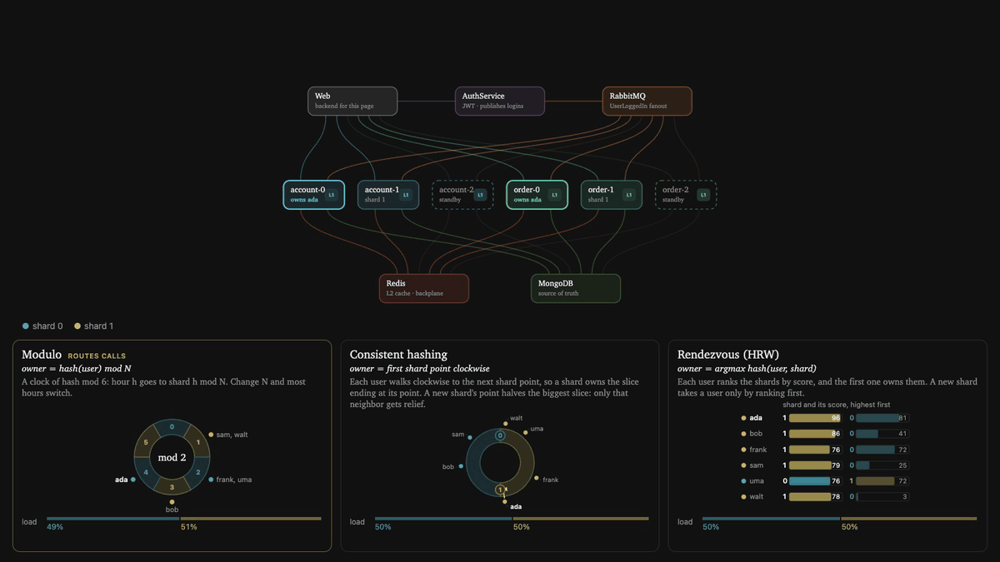
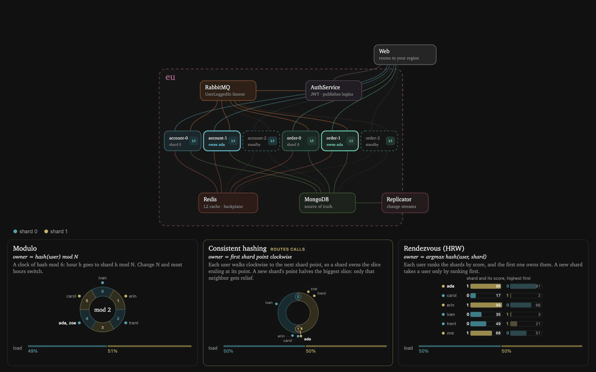
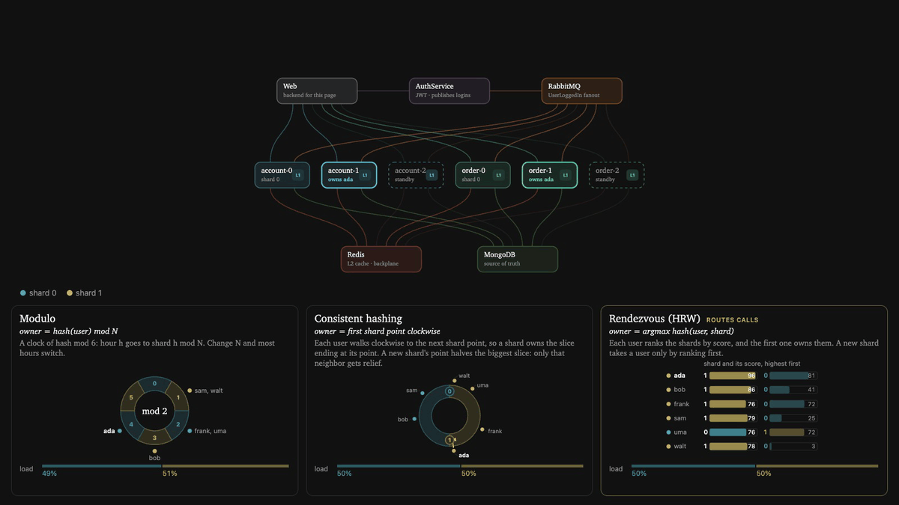
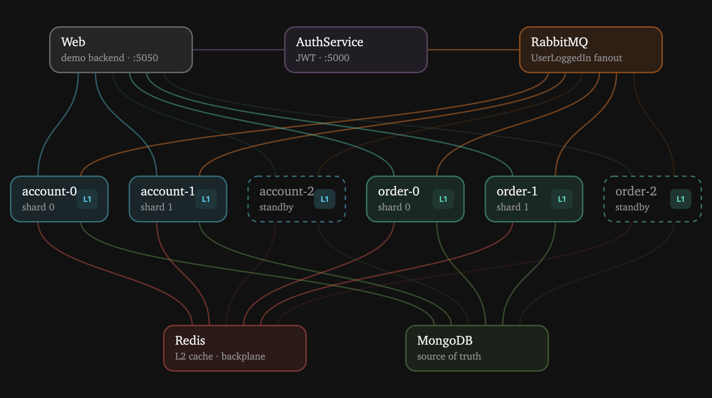

# Sharded hybrid cache

A live, animated demo of a sharded two-level cache in .NET. Each service runs as several shard instances and each instance uses
[FusionCache](https://github.com/ZiggyCreatures/FusionCache) with in-process memory (L1), Redis (L2) and a Redis backplane.
Every user belongs to one shard, which warms its cache the moment that user logs in.

Each service narrates what it does over Redis pub/sub. The demo page plays the narration back step by step: a dot travels each hop, colored by what happened (hit, miss, ignored, rejected).


## Walkthrough

These are real recordings of the demo page's animation running against the app at 1× speed, with the controls and log left out.
The app starts with 2 shards, so 4 service instances take part:
account-0, account-1, order-0 and order-1. (account-2 and order-2 also run, on standby until you [scale out](#scaling-out-modulo-ring-or-hrw).)
The user is `ada`, and with the default modulo routing `md5("ada") % 2` makes **shard 0 her owner**.

### 1. No token, no entry


Before logging in, **Get account** goes to account-0 without a JWT. The gRPC service rejects it with `Unauthenticated` (red),
so the request never reaches the cache.

### 2. Logging in warms the owner's cache


1. AuthService issues a JWT and publishes `UserLoggedIn` to a RabbitMQ fanout exchange.
   The page gets its token right away. The rest happens in the background.
2. RabbitMQ delivers the message to every instance, the standby ones too, and each one checks who owns `ada`.
   account-0 and order-0 own her, so they start warming their caches. The rest ignore the message (grey).
3. The owners have never seen `ada`, so they miss in L1 (memory) and in L2 (Redis). They load her account and orders from MongoDB and save them to L1 + L2.
4. Saving also sends a backplane message. The other instances hear it, but they hold no copy, so there's nothing to refresh.

### 3. Owner shard: an L1 hit


**Get account** goes to account-0, the owner. Login already put `ada` into its memory, so this is an L1 hit, answered
without a single network hop. This is the path that sharding by user is built for.

### 4. Wrong shard: the cold path


The same call goes to account-1 this time. The orange request means it's not the owner. Its memory is empty, so L1 misses.
Redis has the copy the owner saved at login, so L2 hits and the value is copied into account-1's memory.
There's no database trip, but there is a network hop that the owner would have skipped.

### 5. An update every instance hears


**Update account** runs on the owner, account-0:

1. It writes MongoDB first, the source of truth, and then L1 + L2.
2. It publishes a backplane message saying `account:ada` changed.
3. account-1 and account-2 hear it. account-2 holds no copy, so there's nothing to do. The wrong-shard read in step 4 left account-1 holding one in L1, which is now stale, so it refreshes that copy from Redis.

No instance serves the old value, and no instance had to go back to the database for the new one.

### Scaling out: modulo, ring or HRW

The **Cluster** panel sets how many shards are in (the rest wait on standby) and how users are routed to them.
Every service reads both from Redis on each login, so a change applies right away. Adding a third shard to 3,000 users:

| Routing | Users that get a new owner | Users per shard afterwards |
|---------|----------------------------|----------------------------|
| **Modulo**, `hash % shards` | 66%: almost every remainder changes | 973 / 1002 / 1025 |
| **Ring** (consistent hashing, one point per shard) | 23%, all of them to the new shard | 1584 / 717 / 699 |
| **HRW** (rendezvous: every shard scores the user, the highest wins) | 32%, all of them to the new shard | 1028 / 997 / 975 |

Ring and HRW both move only what the new shard takes over. The ring's points aren't hashed here: each new shard's point
halves the biggest slice, the way Cassandra assigned tokens by hand, so points never crowd together on the page.
Even so, a new shard relieves only the one neighbor it splits, which is why real rings place many virtual points per shard.
HRW is even without them.

A user who moves starts cold on their new owner: the first call misses L1, and Redis (L2) answers it.

The **Hashing** tab under the diagram explains all three side by side, with the users who logged in:
a clock of hash remainders for modulo, the ring cut into one slice per shard for consistent hashing,
and each user's ranking of the shards for HRW.
Each change animates who moves. Each card's footer then compares the share of all users that got a new owner
with the least any strategy must move to keep the shards even: a third, going from 2 to 3 shards.
A handful of logged-in users is too few for those rates, so the cards measure them, and the load bars, on 1,000 test users.
The trace log is one tab over.

Each recording below starts the same way: 2 shards, six users logged in, and `ada`'s data warm in her owner's L1.
Then a third shard joins, and `ada` makes her next call.

#### Modulo: most users move



With 3 shards, almost every hour on the clock changes color: 4 of 6 users get a new owner (64% of all users, where 33% would keep the shards even).
`ada` is one of them. Her call lands on account-1, whose L1 has never seen her, and Redis answers it.

#### Consistent hashing: only the new shard's arc moves



Shard 2's point halves shard 1's slice and takes the first half: 2 of 6 users move (25% of all users: less than the 33% an even split needs).
`ada` stays on account-1, so her call is still an L1 hit. The load bar shows the catch: shard 0 still holds half the keys, because only shard 1 got relief.

#### Rendezvous (HRW): few move, and the load stays even



Shard 2 slots into every user's ranking, but takes only the users where it lands first: 2 of 6 (34% of all users, just the 33% an even split needs).
`ada` stays on account-1 and hits L1, and every shard keeps a third of the load.

### Two regions: a user's data lives in one

The app runs the whole system twice, as region **eu** and region **us**, behind one Web. Each region has its own Redis, RabbitMQ, MongoDB,
AuthService and shards. Nothing is replicated between them, not even the backplane.
Instead, every user has a **home region**: the region of their first login, which signs them up there.
Their data lives only in that region's MongoDB, and the JWT carries the region in a `home` claim. Another region still serves the user from its own cache:

- **A read** that misses L1 and L2 loads from the home region's MongoDB, and caches the value in this region's L1 + L2. The dot crosses regions and comes back.
- **A login** in another region warms the owner shard the same way, from the home region's MongoDB. It doesn't move the user's home.
- **A write** goes only to the home region's MongoDB, then saves to this region's L1 + L2 as usual. Every write records the region that made it, in a `writtenBy` field.

That leaves eviction: a region caching another region's users never hears that region's backplane.
So Debezium's MongoDB connector streams each region's MongoDB into Kafka, one topic per collection (`eu.accounts.accounts`, ...),
and every instance of a service in a region joins one consumer group for every region's topics. Kafka gives the feed to one of them,
and that one evicts every change another region wrote: a write in the home region evicts
the other regions' copies, and a write from another region evicts the home region's. A region's own writes aren't evicted, because they
already saved the new value to the cache. The evicting instance's backplane message then drops every other copy in its region.
It stays cheap because users mostly stay in one region: when us never cached `ada`, the eviction is a Redis delete and a pub/sub message.
The eviction is never early, either: every region reads the user from the home database, which has the write before its change feed reports it.
Facebook's memcache invalidates the same way, with a daemon tailing the database's commit log.

The diagram draws both regions side by side, their MongoDBs facing each other across **Debezium · Kafka**, and an eviction's dot goes from it to whichever instance Kafka gave the feed to.
The **Region** picker sets where your calls go, like the region a user's traffic lands in. Switching doesn't log you in:
your JWT works in either region, since both trust the same signing key, but only a login warms that region's owner shard.

1. Log in as `ada` in eu. It's her first login, so eu becomes her home. Pick **us** and run **Get account** on shard 1.
   It misses L1 and L2, and loads from eu's MongoDB.
2. Pick **eu** and run **Update account**. eu writes, saves and sends its backplane message as always. Then Debezium hands the change to Kafka (`cdc-out`),
   and the us account instance reading the feed gets it from Kafka and evicts `account:ada` (`cdc-in`). us's backplane drops the other copies.
3. Pick **us** and run **Get account** again. Both levels miss, it reads eu's MongoDB again, and returns the new name.
4. Run **Update account** in us. The write crosses to eu's MongoDB, us saves its own L1 + L2, and an eu account instance evicts eu's copies through Kafka.
5. Log in as `ada` in us. Her home stays eu, so us's owner shard warms its cache from eu's MongoDB.

The consumer group is per region and service (`eu-account`), and it commits its offset after each eviction.
So when the instance reading the feed stops, another one takes over where it left off: stop the us account instance that told `cdc-in`
in the Aspire dashboard, update `ada` in eu, and another us account instance evicts `account:ada`.
A clean stop hands the feed over at once; after a crash, Kafka waits out the consumer's session timeout (45 s) first.

## Architecture



- **Web** serves the demo page and forwards its calls to the region the page picked. It's the one piece both regions share, like a global front door.
  It uses HTTP to reach AuthService and gRPC to reach the shard instances, because browsers can't call gRPC.
- **AuthService** issues JWTs and publishes `UserLoggedIn` to a RabbitMQ fanout exchange, which delivers it to every instance.
- **account-N** and **order-N** each keep an L1 cache in their own memory. They share Redis for L2 and the backplane, and fall back to MongoDB.
- AuthService, RabbitMQ, the instances, Redis and MongoDB run once per region. A user's data lives only in their home region's MongoDB, and the other regions read and write it there.
- **Debezium** streams every region's MongoDB into **Kafka**, and one instance of each service per region, picked by its consumer group, evicts from there when another region changed a user's data.

[.NET Aspire](https://aspire.dev) runs everything. It starts the services and the Redis, RabbitMQ, MongoDB, Kafka and Debezium containers, and it collects traces, metrics and logs in its dashboard.
It also registers each region's Debezium connector once Debezium is up.

## Run it

You need the [.NET 10 SDK](https://dotnet.microsoft.com/download) and Docker or Podman.

```sh
dotnet run --project AppHost
```

- Demo page: http://localhost:5050
- Aspire dashboard: http://localhost:15000 (the login link is printed in the console)

With Podman, first run `export ASPIRE_CONTAINER_RUNTIME=podman`. Kafka and Debezium run with small JVM heaps, so everything fits in Podman's default 2 GB machine.
The first run pulls the Debezium image, which is 1.6 GB.
`shards` in [`AppHost/AppHost.cs`](AppHost/AppHost.cs) sets how many instances each service runs, and `regions` sets which regions run. The page's **Cluster** panel picks how many of them are in.

## Using the page

1. **Log in** with any name. The owner shard is highlighted in the diagram.
2. **Pick an action**, such as Get account or Add order. It opens with its fields and a shard picker, which defaults to the owner. Press **Run**.
3. Watch the story. Use **Speed** to slow it down, or turn on **Step by step** and advance with the button, `→` or a presenter clicker (`PageDown`).
4. Turn on **Show TTL** to see how long each cached copy has left. Entries live a minute in L1 and two minutes in Redis, and when one runs out of L1 the page plays its eviction.
5. Use **Cluster** to add or remove a shard, or to switch routing between Modulo, Ring and HRW, and watch the **Hashing** tab. Log in a few users first so there's someone to move.
6. Use **Region** to send your calls to the other region. The Cluster panel switches to that region's shards and users. Log in there to warm its owner shard.
   Outside the user's [home region](#two-regions-a-users-data-lives-in-one), a miss reads the home region's MongoDB.

## Project layout

| Path | What's in it |
|------|--------------|
| `AppHost/` | Aspire orchestration: containers, services, instances per service, ports |
| `AuthService/` | Login: finds the user's home region (or signs them up), issues the JWT, publishes `UserLoggedIn` |
| `AccountService/`, `OrderService/` | Sharded gRPC services behind JWT, reading through FusionCache |
| `Shared/Demo.cs` | What the services share: JWT setup, FusionCache config, cache warming on login, the home region's database, and the eviction after another region's write |
| `Shared/Cluster.cs` | Routing: the shard count and strategy kept in Redis, and the modulo, ring and HRW owner lookups |
| `Shared/Timeline.cs` | The narration: turns FusionCache events into steps for the page |
| `Web/` | Backend for the page (browsers can't call gRPC) and `wwwroot/index.html`. GSAP is vendored so it works offline |

## Demo shortcuts

This is a conference demo, not production code:

- There are no passwords: any name gets a token. The JWT signing key is hardcoded in `Shared/Demo.cs`.
- Each instance listens on a throwaway RabbitMQ queue, so logins that happen while a shard is down are lost.
- A user's data lives in one region only, with no copy anywhere else. If that region's MongoDB is down, no region can serve the user's misses or writes.
  Production keeps replicas for disaster recovery, and the caches don't need to know about them.
- AuthService finds a user's home by asking every region's MongoDB, and first logins in two regions at once sign the user up twice. Production keeps one global user directory.
- A read in another region that starts just before a write can put the old value back right after the eviction. Real systems close that window with leases.
- One Kafka and one Debezium serve both regions. Production runs a Kafka per region, next to its database, and mirrors the topics across with MirrorMaker 2, placed next to the target cluster.
- Debezium reaches MongoDB without TLS, since its JVM doesn't trust Aspire's development certificate. MongoDB accepts both (`preferTLS`), and the services keep using TLS.
- Every instance tries to create the Kafka topics, one partition each, so the consumers are reading before Debezium's first change. Production would create them with the cluster.
- Debezium can't narrate, so the instance that evicts tells the `cdc-out` step on its behalf, once the change reaches it.
